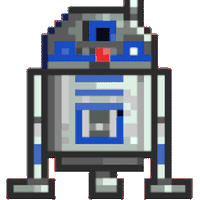

<h2> Well hello there! </h2>
I'm Brieuc, but you can call me Bryan if that's easier! 

You might also know me as wharkk.


<h3><picture><source media="(prefers-color-scheme: dark)" srcset="./assets/modulescript-dark.png"></picture> A little about me</h3>

```lua
local wharkk = {
    language = "Luau",
    workspace = "Roblox Studio",
    testing = "Jest",

    enjoys = {
        "Making interactions feel good",
        "Finding my way around existing codebases",
        "Building tools I'll actually use",
    },

    projects = { "RoGit", "Slime TCG", "UDX" },
}

return wharkk
```

 <a href="https://wharkk-developer.framer.website/">Portfolio</a> &nbsp;
 <a href="https://www.roblox.com/users/823639953/profile">Roblox</a> &nbsp;
 <a href="https://www.linkedin.com/in/brieuc-guillermic-311521298/">LinkedIn</a>

🎮 See my gameplay demos and project contributions on my [portfolio](https://wharkk-developer.framer.website/).
