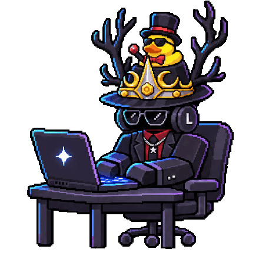
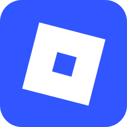

<h1> Hello there! </h1>
<p>I'm Brieuc, but you can call me Bryan if that's easier! 
<br />
You might also know me as wharkk  
</p>



<h3><picture><source media="(prefers-color-scheme: dark)" srcset="./assets/modulescript-dark.png"></picture> A little about me</h3>

```lua
local wharkk = {
    language = "Luau",
    workspaces = { "Roblox Studio", "Rojo" },
    testing = "Jest Roblox",

    enjoys = {
        "Creating experiences players want to stay in",
        "Building tools I'll actually use, and might help others",
        "Drinking coffee"
        -- ☕ What goes best with a cup of coffee? Another cup!
    },

    contributions = {
        ["Build A Cart"] = {
            role = "Gameplay & live ops (+ revival)",
            gameStats = "500 -> 19k+ peak CCU, 122.5M+ visits",
        },
        ["Steal A Brainrot Egg"] = {
            role = "Gameplay, UI & map, built in ~25h",
            gameStats = "13k peak CCU, 25M+ visits",
        }
    },

    building = { "RoGit CLI", "UDX", "Slime TCG" }
}

return wharkk
```

 <a href="https://wharkk-developer.framer.website/">Portfolio</a> &nbsp;
 <a href="https://www.roblox.com/users/823639953/profile">Roblox</a> &nbsp;
 <a href="https://www.linkedin.com/in/brieuc-guillermic-311521298/">LinkedIn</a>
