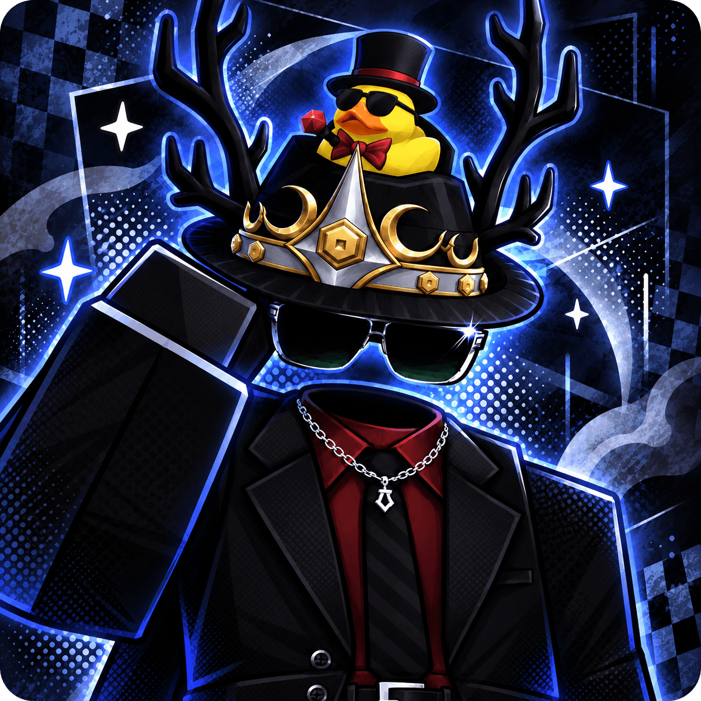

## Hello there!
I'm Brieuc. You might know me as **wharkk**.

Roblox Game Engineer with 7 years of experience building gameplay systems,
supporting live games, and creating tools for fellow developers.

<a href="https://wharkk-developer.framer.website/"> Portfolio</a> &nbsp;·&nbsp;
<a href="https://www.roblox.com/users/823639953/profile"> Roblox</a> &nbsp;·&nbsp;
<a href="https://www.linkedin.com/in/brieuc-guillermic-311521298/"> LinkedIn</a>


<h3><picture><source media="(prefers-color-scheme: dark)" srcset="./assets/modulescript-dark.png"></picture> A little about me</h3>

```lua
local wharkk = {
    language = "Luau",
    workspace = "Roblox Studio",
    testing = "Jest",

    enjoys = {
        "Making interactions feel good",
        "Finding my way around existing codebases",
        "Building tools I'll actually use",
    },

    projects = { "RoGit", "Slime TCG", "UDX" },
}

return wharkk
```

<a href="https://luau.org/"> Luau</a> &nbsp;·&nbsp;
<a href="https://create.roblox.com/docs/studio"> Roblox Studio</a> &nbsp;·&nbsp;
<a href="https://github.com/Roblox/jest-roblox"> Jest</a>

<br clear="right">

### Things I've built

**[RoGit](https://github.com/Wharkk/RoGit-Plugin)**  
GitHub integration for Roblox Studio, with a Luau diff viewer and conflict checks.

**[Pest Luau](https://github.com/Wharkk/pest-luau)**  
PestPHP-inspired testing for Roblox, with chainable assertions and test lifecycle hooks.

<details>
<summary>The story behind Pest Luau</summary>

> I built it because I loved [PestPHP](https://pestphp.com/)'s syntax and wanted
> something similar in my Roblox workflow. At the time, I hadn't discovered
> Jest or TestEZ, and I now use Jest in my current projects.

</details>

### See it in action

Find gameplay clips, playable demos, and project contributions on my
[portfolio](https://wharkk-developer.framer.website/).
